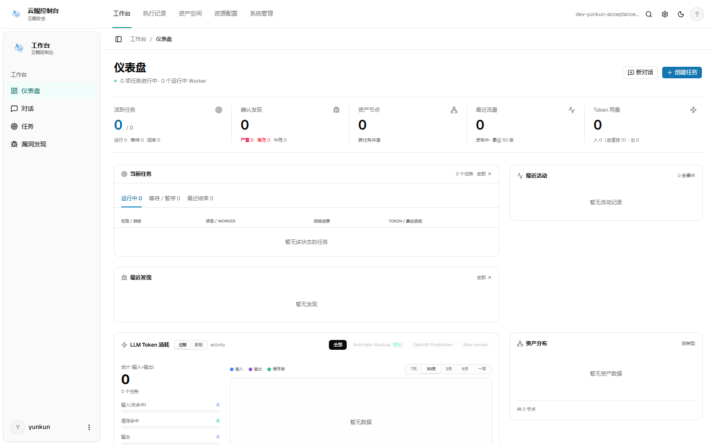
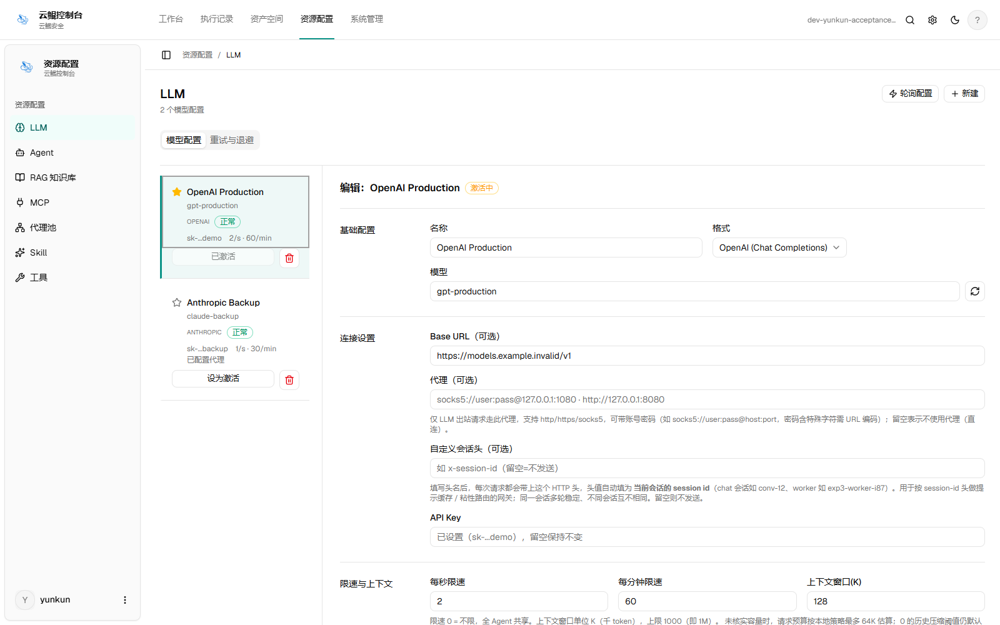
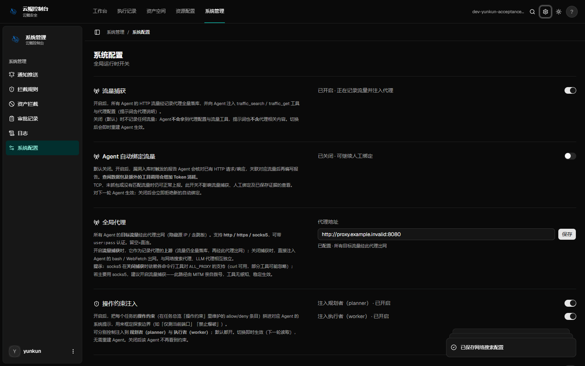
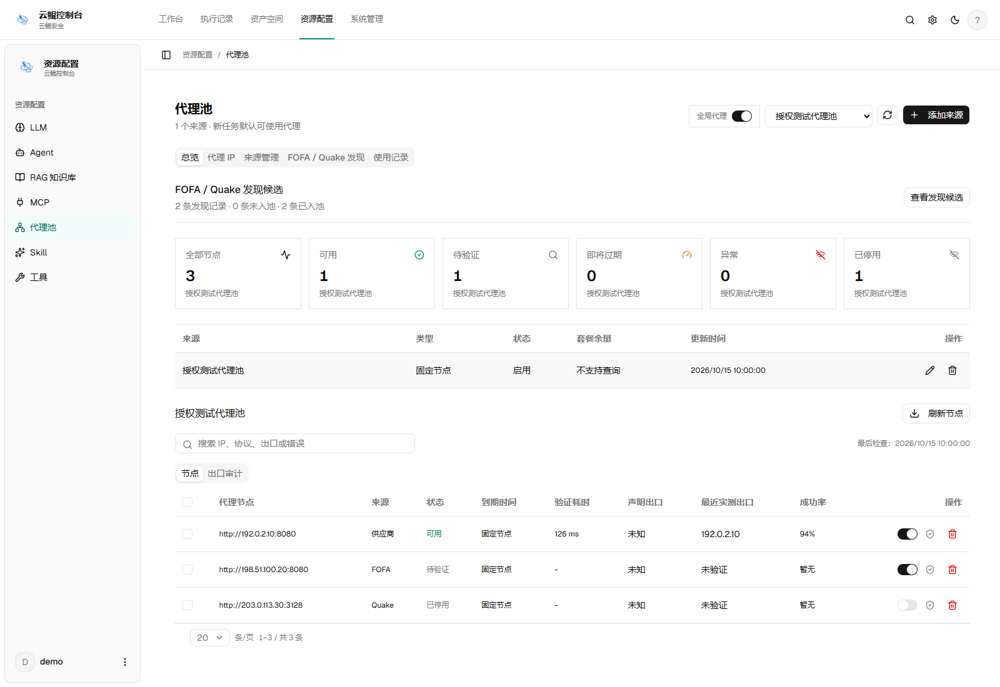
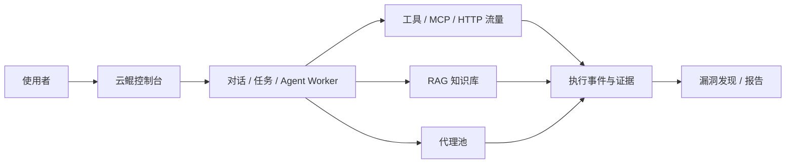

# 云鲲自动化渗透控制台

让授权安全测试的任务、执行过程与结果证据集中在一个工作台

Rowan · 云鲲安全

**产品介绍与使用指南 · 2026-10-15**

[界面预览](#界面预览) · [功能介绍](#功能介绍) · [使用流程](#使用流程) · [新增与优化](#新增与优化) · [部署说明](#部署说明)

> 本仓库提供产品介绍、界面预览、源码和 Windows 完全离线交付包。下文介绍当前交付代码中的能力，不代表全部场景已完成实测。

## 获取产品

- 源码：[`source/`](source/)
- Windows 完全离线版：见 [Releases](https://github.com/Haryy985/yunkun-console-preview/releases)
- 在线构建版：源码目录中的 `setup-and-start.bat` 会在首次启动时下载依赖并编译

完全离线版已包含编译后的控制台和 PostgreSQL 运行时。解压后双击 `setup-and-start-offline.bat`，不需要 Go、Node.js、npm、Docker 或联网下载依赖。

## 云鲲是什么

云鲲自动化渗透控制台是一套面向授权安全测试的 Agent 工作台，将对话、任务、工具、知识库、代理资源、HTTP 流量、漏洞发现与报告集中管理。

使用者可以通过对话整理测试需求，在任务中管理执行过程，查看 Agent 的工具调用与检索记录，对需要确认的操作进行审批，再依据请求、响应和证据整理漏洞报告。

它重点解决三个问题：任务正在做什么、结果依据在哪里、别人能否按报告复现。AI 负责辅助执行与整理，授权边界、知识变更和结论复核仍由使用者掌握。

## 界面预览

默认亮色，支持暗色切换。导航按工作台、执行记录、资产空间、资源配置和系统管理组织，方便在任务执行与资源配置之间切换。

### 仪表盘

登录后先进入仪表盘，集中查看任务与安全发现等信息。截图来自独立空库，零值为演示环境数据。

### 模型与系统配置

| 模型配置 | 系统配置 · 暗色 |
| :---: | :---: |
|  |  |

模型配置采用列表与详情分区，配置项按用途组织。截图使用测试数据及模拟配置接口，不代表已接通真实模型或代理服务；点击图片可查看原图。

### RAG 知识库

展示知识空间、文档处理状态及人工审核入口。图中文档、切片数量与审核提案均为脱敏演示数据，不是实际导入或检索验收结果。

### 代理池

展示来源、节点状态与 FOFA / Quake 发现入口。图中地址使用保留的文档示例 IP，状态和出口记录由模拟接口提供，不代表这些代理真实可用或已完成联网验证。

## 功能介绍

| 模块 | 可以做什么 |
| --- | --- |
| 对话与任务 | 通过 Agent 对话处理需求，管理任务规划、Worker、模板、暂停、归档和批量操作 |
| 执行流水 | 查看工具调用、模型请求、检索、审批及异常事件，按类型筛选并展开详情 |
| 上下文与引用 | 查看 Token 用量、上下文水位、检索切片、评分、来源及关联请求 |
| RAG 知识库 | 导入文档、文件夹或 ZIP，按任务限制访问范围，审核 Agent 的知识变更提案 |
| 代理资源 | 管理固定代理与第三方来源，发现、验证、启停节点，查看任务使用和出口审计 |
| 流量与漏洞发现 | 查阅 HTTP 请求与响应，关联 Finding 和证据快照，辅助人工复核 |
| 报告 | 以漏洞描述、URL、HTTP 请求包和关键响应组织复现材料 |
| 资源与扩展 | 配置模型、工具、MCP 和 Skills，按实际部署扩展执行能力 |

### 任务过程：从状态直接进入流水

点击任务名称进入详情，点击运行状态或 Worker 打开执行流水抽屉。默认关注关键事件，需要时再展开工具输入输出、模型请求、HTTP 记录与检索引用，不必为了看一次执行情况反复跳转页面。

任务详情中的“上下文与引用”用于核对查询、Top-K 切片、评分和来源。检索返回与请求实际包含分别标记，避免把“搜到了”当成“模型已经使用并得出了正确结论”。

上下文水位按具体模型窗口和相应请求计算，达到 85% 提醒；没有可靠窗口数据时显示“未知”。累计 Token 用来观察总用量，不能拿来代替当前上下文占用。

这里展示的是可审计的执行记录与摘要，不是模型内部隐藏的思考过程。

### 知识库：支持导入，也支持审核式积累

知识库支持文本、PDF，以及 DOCX、XLSX、PPTX 等格式解析，并提供多文件、文件夹和 ZIP 批量导入。导入过程会分别处理成功、重复、跳过和失败的文件，不将一个失败文件混成整批成功。

任务可以绑定可访问的知识库。Agent 遇到需要补充的方法、经验或纠正内容时，可以提交知识新增或修改提案，人工审核通过后才生效，不直接改写正式知识。

检索以有限切片和摘要进入请求，配合长度限制与输入预算检查，降低大段文档挤占上下文的风险。它不是“永远不会超窗”的保证，复杂长任务仍需关注实际用量。

扫描 PDF、加密文档和旧版 Office 文件不属于通用解析保证范围；批量压缩包导入指 ZIP，不代表支持所有压缩格式。

### 代理资源：来源、发现、验证、启用分开管理

支持固定代理节点、小象代理及通用 JSON API 来源，也提供 FOFA / Quake 查询入口。可以保存查询后手动执行，设置每次获取数量（1–100），分页查看结果，再按授权范围验证与手动启用。

节点管理包含启停、状态、到期信息、任务使用和出口检查记录。发现候选节点不等于可以使用：即使保存查询时未填写授权范围或验证地址，后续验证与入池仍需要满足相应条件。

任务中的 Agent 可通过资源与网络状态工具了解授权知识库和代理策略。受管 HTTP 路径按任务代理租约执行，代理失败不自动回退直连；外部脚本、浏览器、远程扩展和自行建立的连接仍需单独检查，不能据此宣称全机流量都经过代理。

### 报告：以 HTTP 请求包交付复现过程

报告围绕“漏洞简介 → 漏洞描述 → 漏洞 URL → 复现过程 → 关键响应与证据”组织，不再仅依赖 curl 命令表达复现步骤。

存在已记录请求时，优先提供便于复制检查的 HTTP 请求包；没有捕获到完整请求时明确标记缺失或截断，不根据一个 URL 编造原始报文。整理后的请求包用于复现，不承诺与网络传输字节完全一致。

证据快照保留发现对应的材料，便于后续复核。导出前仍需检查并脱敏 Cookie、令牌、个人信息与业务数据；HTTPS CONNECT 本身不代表已经解密捕获完整请求。

## 工作方式

云鲲控制台把任务执行、资源访问和证据整理放在同一条可追溯链路中。下面是面向使用者的概念关系图，实际部署是否启用某个模块，取决于配置、权限和外部服务可用性；它不代表每个环境都已经完成完整的真实目标验收。

RAG 知识库和代理池是 Rowan / 云鲲安全在原始源码基础上后续新增的业务模块。它们都需要单独配置和核验：知识库检索结果不等于已经进入模型请求，代理节点发现结果也不等于已经获得使用授权或验证可用。

## 使用流程

### 1. 配置模型与执行资源

部署完成后登录控制台，在资源配置中填写模型服务地址、凭据与模型参数，再按任务需要配置工具、MCP 或 Skills。先检查连接与可用性，再启动实际任务。

模型和外部测试工具需要使用者自行准备；启动控制台不会自动提供可用模型，也不会安装所有测试工具。

### 2. 准备知识库与代理

在知识库中创建条目并导入文档，检查解析结果。需要代理时添加来源或节点，完成授权范围与连通性验证后再启用。

使用 FOFA / Quake 时，先配置平台凭据，保存查询并手动执行；检查分页结果、验证状态与实测出口，再选择允许任务使用的节点。查询结果不自动构成端点使用授权。

### 3. 创建任务并明确范围

填写目标、测试目的与约束，选择允许访问的知识库、工具及代理策略，再启动任务。重复任务可以使用模板，但代理选择不能假定随模板保存，创建时仍需核对。

任务级授权绑定与普通对话的资源访问不是完全相同的路径，不应假定任务限制会自动覆盖所有独立对话。

### 4. 跟踪运行与处理审批

在仪表盘或任务列表查看状态，点击状态打开流水，检查工具结果、失败原因、Token 与上下文信息。需要人工确认的操作和知识变更先审核，再继续相应流程。

引用和关系图用于沿已有记录核对来源；没有明确 ID 关联的部分不能视为已经证明的完整因果链。

### 5. 复核发现并整理报告

进入漏洞发现与流量记录，核对受影响 URL、请求、响应及证据。确认结论后整理报告，检查 HTTP 复现包、敏感信息和证据是否齐全，再对外交付。

## 新增与优化

以用户提供的最初源码为对照，RAG 知识库和代理池（包括 FOFA / Quake 发现）是 Rowan / 云鲲安全后续开发新增的业务模块，并非原始源码自带。对话、任务等既有基础能力继续保留和改进；下表同时列出新增模块与其他优化，不将整个产品描述为从零开发，也不对应已发布的版本标签。

| 方向 | 新增或改进内容 | 对使用者的帮助 |
| --- | --- | --- |
| 任务可观测性 | 状态与 Worker 流水入口、上下文与引用视图、用量与容量提示 | 少跳转，能核对过程与来源 |
| 新增 RAG 知识库 | 文档解析与切片、检索引用、任务访问限制、Agent 知识修订提案和人工审批 | 知识可积累，引用可核对，变更先审核 |
| 知识库导入优化 | 修复创建入口与二进制文档的 UTF-8 入库错误，补充文件夹、ZIP 和批量导入反馈 | 文档解析与失败原因更清晰 |
| 新增代理池 | 固定节点与第三方来源、FOFA / Quake 手动发现、数量与分页、节点验证、启停和出口审计 | 从发现到使用有可检查的步骤 |
| 复现材料 | HTTP 请求包与关键响应、证据快照、缺失材料提示 | 减少只靠 curl 复现的整理成本 |
| 执行与登录恢复 | 执行事件持久化、重连补读；区分暂时数据源故障与真实认证失效 | 减少流水丢失和暂时故障导致的误退登录 |
| Skills 导入 | 规范 ZIP 中的 Windows 路径，同时保留越界路径检查 | 改善压缩包兼容性，不放开危险路径 |
| 界面布局 | 云鲲品牌、仪表盘入口、分组导航、配置列表与详情分区、亮暗色 | 保留功能和常用字段，调整信息层次 |
| 原生启动 | Windows 双击下载依赖、编译、启动独立数据库与就绪检查 | 无需 Docker，减少首次搭建步骤 |

上述修复和改进不等于所有环境、历史数据和真实攻防链路均已验证。具体部署仍需结合模型、工具、权限及网络条件检查。

## 部署说明

采用原生部署路线，不要求 Docker。源码交付包和完全离线版分别提供两种启动方式。

完全离线版：从 [Releases](https://github.com/Haryy985/yunkun-console-preview/releases) 下载压缩包，解压后双击 `setup-and-start-offline.bat`，等待本机数据库初始化和应用就绪。

Windows x64 全新安装的操作路径：

1. 将完整源码包解压到当前账号可写的较短目录，例如 `F:\yunkun`。
2. 双击 `setup-and-start.bat`，首次联网下载依赖、编译并初始化独立 PostgreSQL。
3. 等待 `Ready`，打开 `http://127.0.0.1:5173/`，使用账号 `yunkun` 并首次设置密码。
4. 后续双击同一入口启动。停止前先确认任务状态，再运行 `stop-local.bat` 并输入 `STOP`。

| 项目 | 当前约定 |
| --- | --- |
| 应用入口 | 默认仅监听本机 `127.0.0.1:5173` |
| 独立数据库 | 默认仅监听本机 `127.0.0.1:5433` |
| 管理员密码 | 首次自行设置，不提供统一默认密码 |
| 端口冲突 | 停止并提示，不抢占其他服务 |
| 私有数据 | 不随源码、截图或文章发布 |

启动器会校验固定依赖包，只有数据库认证与应用就绪检查通过后才报告成功。`.yunkun-local/` 保存数据库、配置、密钥和日志，不应公开或为了重启而删除；停止服务会中断任务。

旧环境迁移与全新安装需分开处理，不能直接覆盖业务数据库，也不能通过删除旧配置强行让安装器接管。

## 使用须知

当前已有前后端构建、48 项安装器回归、32 项独立空库服务断言与 8 组界面检查记录。这些来自已有 Windows 环境，部分界面配置接口使用模拟数据，不代表真实模型、代理及完整任务链路全部验收通过。

真实模型与代理的整链路验收、历史数据迁移、完整权限与依赖审查，以及干净系统安装仍有待补齐；Linux / macOS 暂无实测结论。当前不提供已发布的签名安装程序或公共 Demo。

原生 Agent 使用运行账号的本机权限，不提供容器隔离。请在专用、低权限环境中运行，不直接向公网暴露控制台或数据库。所有目标测试、代理验证和端点使用都应在明确授权范围内进行。

## 来源说明

云鲲自动化渗透控制台由 Rowan / 云鲲安全维护，基于 [Autumn-27/ARTEX](https://github.com/Autumn-27/ARTEX) 二次开发，保留对原作者 Autumn-27 及原项目贡献者的来源说明，不将继承代码描述为从零独立编写。

仅用于合法授权的安全测试。第三方平台查询结果不自动构成对相关端点进行测试或使用的授权。

### 允许使用范围

- 仅可用于**阅读、学习与研究本项目源码**，以及在**本地隔离环境**中进行技术原理验证；
- 适用于个人学习、学术研究、代码审阅等非攻击性用途。

### 禁止事项

- **严禁使用本工具对任何网站、线上服务或联网系统发起扫描、探测、利用或攻击**（无论是否获得授权、是否为自有资产）；
- 严禁将本工具用于任何实际的渗透测试、攻防对抗或生产环境；
- 严禁将本工具用于非法入侵、数据窃取、勒索、拒绝服务或任何破坏性、犯罪性活动；
- 严禁利用本工具从事违反所在国家/地区法律法规的行为。

### 合规责任

使用者须自行遵守所在国家/地区关于网络安全、数据保护与计算机犯罪的全部法律法规（在中国大陆包括但不限于《网络安全法》《数据安全法》《个人信息保护法》及相关司法解释）。**因使用本工具产生的一切法律责任与后果，均由使用者自行承担。**

### 免责声明

本项目按“现状（AS IS）”提供，不附带任何明示或默示的担保。作者及贡献者不对使用本工具（无论使用方式是否得当）所导致的任何直接或间接损失、数据丢失、系统损坏或法律纠纷承担责任。**下载、安装或使用本项目，即表示你已阅读、理解并同意上述全部条款。**
