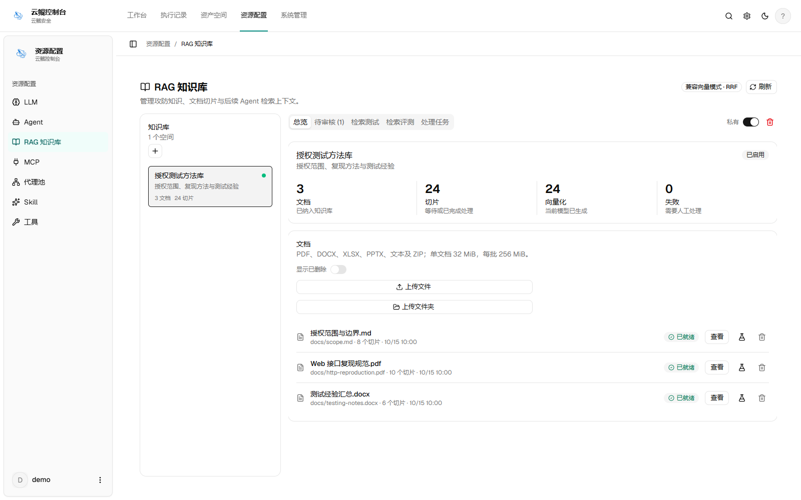

<div align="center">


# 云鲲自动化渗透控制台

v1.1.2 源码 · Windows / Linux / macOS 完整离线版另见 Releases

对话与任务 · 执行流水 · RAG 知识库 · 代理资源 · HTTP 证据

Rowan / 云鲲安全

</div>

> 本项目仅用于合法授权的安全测试。请在隔离、低权限环境中运行，不要将控制台或数据库直接暴露到公网。

## 从源码开始

当前 `source/` 是可审计源码，不包含预编译程序或 PostgreSQL 运行时。
Windows 用户可双击 `setup-and-start.bat`，首次联网下载依赖、编译并启动。
需自行构建时参考 [原生部署手册](docs/DEPLOYMENT.md)；先生成前端并同步到
`server/webui/current`，再以 `-tags embedui` 编译，避免得到没有页面的开发二进制。
源码启动器读取 `VERSION`，本次为 `v1.1.2-offline`。

本次变更见 [1.1.2 更新说明](docs/RELEASE_1.1.2.md)，
既往版本记录仍见 [1.0.3 更新说明](docs/RELEASE_1.0.3.md)。
源码随附公开工作流和规则资料，不包含维护者的账号、密钥、数据库或日志。

## 下载离线包后启动

从本仓库 Releases 下载的完整离线 ZIP 包含已编译的云鲲控制台、静态前端和 PostgreSQL 运行时。该 ZIP 的使用者无需安装 Go、Node.js、npm、Docker，也无需联网下载依赖；仓库自动生成的源码 ZIP 不具备这些运行时。

1. 将完整目录解压到可写的短路径，例如 `F:\yunkun-offline`。
2. 双击根目录的 `setup-and-start-offline.bat`。如果目标机缺少 VC++ x64 运行库，启动器会请求管理员权限并使用包内安装器补齐。
3. 等待本机数据库初始化和应用就绪检查完成。
4. 打开 `http://127.0.0.1:5173/`。
5. 使用账号 `yunkun`，首次自行设置控制台密码。

停止服务时双击 `stop-offline.bat`，并在提示时输入 `STOP`。本机数据会保留在 `.yunkun-local/`，该目录属于客户本机运行数据，不应上传或复制给其他人。

| 项目 | 默认值 |
| --- | --- |
| 控制台 | `127.0.0.1:5173`（公网部署使用 `-Public`） |
| 独立 PostgreSQL | `127.0.0.1:5433` |
| 管理员账号 | `yunkun` |
| 默认密码 | 没有统一默认密码，首次自行设置 |
| 网络要求 | 首次和后续启动均不要求联网 |

如果 `5173` 或 `5433` 已被其他程序占用，启动器会停止并提示，不会结束未知进程，也不会修改防火墙。可以使用：

```powershell
.\setup-and-start-offline.ps1 -DatabasePort 55433 -NoBrowser
```

需要通过公网访问时，在云安全组和 Windows 防火墙放行 TCP 5173，然后运行：

```powershell
.\setup-and-start-offline.ps1 -Public -NoBrowser
```

`-Public` 会让控制台监听 `0.0.0.0:5173`；默认仍只监听本机，避免误暴露管理端。

## 功能

| 模块 | 能力 |
| --- | --- |
| 对话与任务 | Agent 对话、任务规划、Worker、模板、暂停、归档和批量操作 |
| 执行流水 | 工具调用、模型请求、RAG 检索、HTTP 记录、审批和异常事件 |
| RAG 知识库 | 文档导入、切片检索、引用追踪、任务访问限制和人工审核 |
| 代理资源 | 固定代理、第三方来源、FOFA / Quake 发现、验证、启停和出口审计 |
| 漏洞与报告 | Finding、请求响应、证据快照和 HTTP 请求包复现材料 |
| 扩展配置 | 模型、工具、MCP、Skills 和系统偏好 |

RAG 知识库和代理池是云鲲安全在原始源码基础上后续新增的业务模块。发现一个知识切片或代理节点，不等于它已经被模型使用、获得授权或验证可用；实际使用仍需按任务范围核验。

## 数据与安全边界

离线包不包含真实模型密钥、代理凭据、数据库数据、运行日志、Cookie、Token、聊天记录或本机缓存。首次启动只会在包内创建随机数据库凭据和空数据库。

模型服务、第三方平台凭据、测试工具和目标授权由部署方自行准备。原生 Agent 使用运行账号的本机权限，不提供容器隔离；代理配置也不等于整机网络隔离。

## 源码与文档

离线 ZIP 包含已编译程序、静态前端和 PostgreSQL 运行时，不包含源码；可审计源码在 GitHub 仓库的 `source/` 目录。首次离线安装和已有安装更新见 [`docs/OFFLINE_UPDATE.md`](docs/OFFLINE_UPDATE.md)；源码自行编译另见 [`docs/DEPLOYMENT.md`](docs/DEPLOYMENT.md)。来源与授权说明见 [`NOTICE.md`](NOTICE.md)，许可证见 [`LICENSE`](LICENSE)。

管理员登录后可在“系统设置 → 版本与更新”检查新版并执行一键更新。Windows x64 标准离线安装会下载校验、停止服务、完整备份、安装并重启；启动检查失败会恢复匹配的旧程序和数据库。1.0.6 等旧客户端仍需按离线更新手册手动升级一次，才能获得此按钮。Linux 标准离线安装已接入同一套受管更新流程，但本版本的 Linux 真机升级验收仍需在原生 Linux 环境完成；其他平台或外部数据库安装继续使用手动升级。

此次 Agent 稳定性修复的范围和未完成验证见 [`docs/agent-reliability-2026-10-16.md`](docs/agent-reliability-2026-10-16.md)。发布压缩包与 SHA-256 校验值以 GitHub Release 附件为准，不要将仓库的源码快照当成离线安装包。

## 界面预览

以下图片使用演示数据，仅用于展示界面布局，不代表真实联网验证结果。


| RAG 知识库 | 代理池 |
| :---: | :---: |
|  |  |

